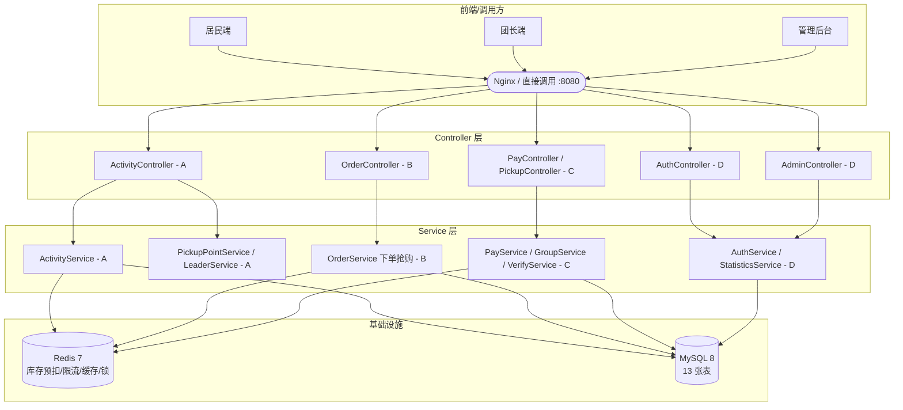

# 系统架构图（A 负责，Issue #15）

> 用 Mermaid 写，GitHub 直接渲染；B 写报告第 4 章时可直接截图或转 PNG。

## 分层架构



## 包结构

```
com.groupbuy
├─ common       统一响应体 R / 错误码 / 业务异常 / 状态机 / 用户上下文   （A）
├─ config       全局异常、Redis、MyBatis 配置                          （A）
├─ redis        Lua 预扣、限流、CacheClient、分布式锁                  （A）
├─ entity       13 张表对应的实体                                      （A/B/C 各自的表）
├─ dto          18 个入参出参类（docs/api.md 冻结）                    （A）
├─ mapper       MyBatis 接口 + XML（动态 SQL）                         （各人）
├─ service      业务逻辑                                               （各人）
└─ controller   18 条接口                                              （各人）
```

## 高可用三板斧（压测取证点）

| 问题 | 解法 | 落点 | 验收 |
|---|---|---|---|
| 缓存穿透 | 空值缓存（查不到也缓存 2 分钟） | `CacheClient` | — |
| 缓存击穿 | 逻辑过期 + 互斥锁，只放一个线程回源 | `CacheClient.getWithLogicalExpire` | #28 回源 ≤1 次 |
| 缓存雪崩 | TTL ±10% 随机抖动 | `CacheClient` | — |
| 超卖 | Redis Lua 原子预扣 + DB CAS 兜底 | `stock_deduct.lua` + `StockMapper.casDeduct` | #27 零超卖 |
| 刷爆接口 | 令牌桶限流，超限 429 | `rate_limit.lua` | — |
