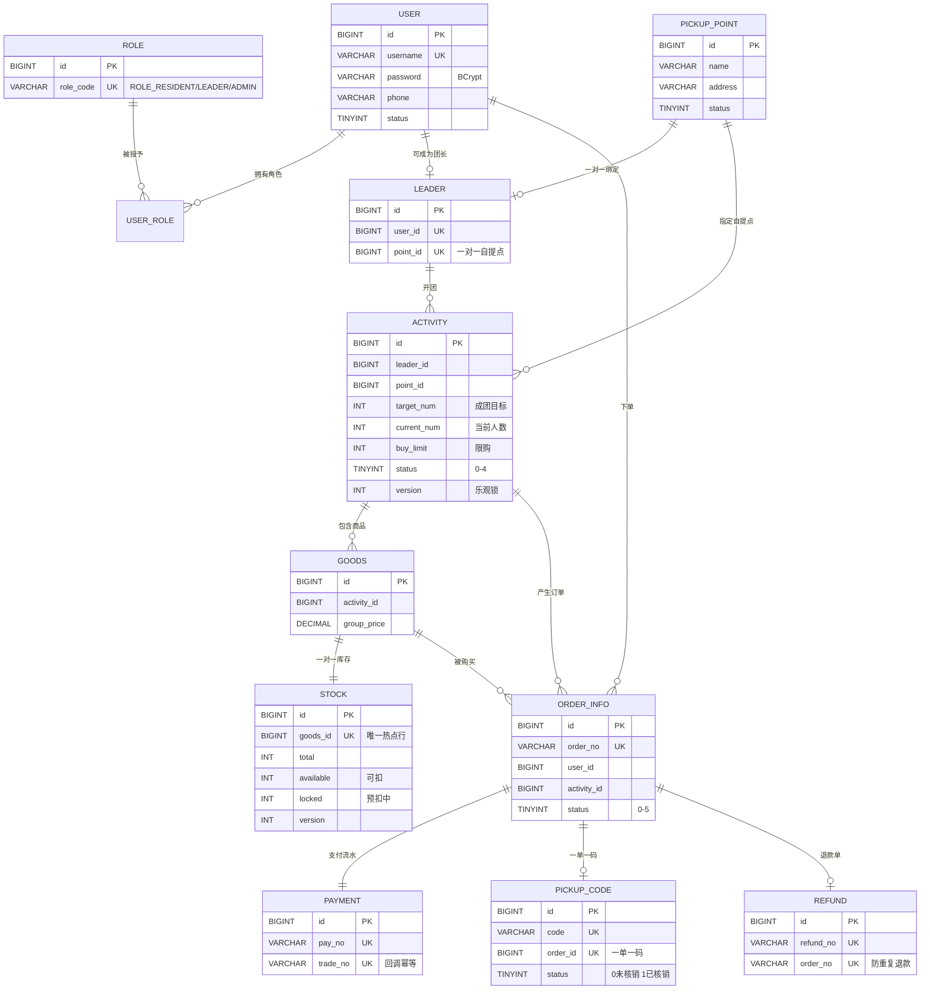

# ER 图（A 负责，Issue #15）

> 逻辑外键，不加物理 FOREIGN KEY（高并发下单会触发父表行锁，拖垮抢购性能）。

## 三个唯一索引兜住并发（报告第 4 章重点）

| 索引 | 挡住的并发问题 | 谁用 |
|---|---|---|
| `order_info.uk_user_activity` | 重复下单 + 超限购 | B（#16 #17） |
| `payment.uk_trade_no` | 支付回调重放 | C（#19） |
| `refund.uk_order_no` | 同一单退两次 | C（#22） |
| `pickup_code.uk_order_id` | 成团回调重入重复发码 | A（#9） |

> 比"先查再插"可靠：那是两步操作，并发下挡不住；唯一索引是数据库层面的原子拦截。
