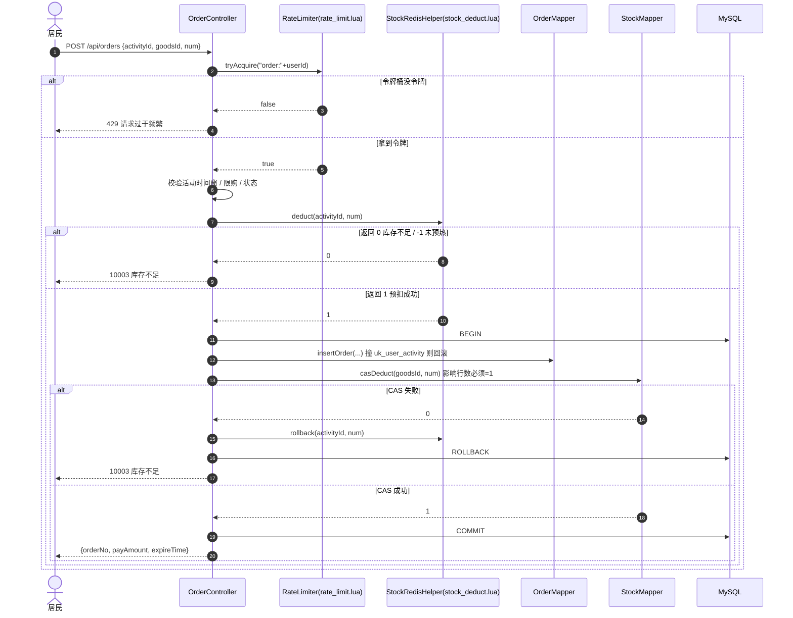

# 时序图：参团下单（B 负责，Issue #16）

> 三步缺一不可：限流 → Redis 预扣 → DB CAS 落库；任一步失败都要回滚预扣。
> 对应验收要点①：200 并发 1000 库存零超卖。

## 为什么是"Redis 预扣 + DB CAS"两层

| 层 | 作用 | 挡什么 |
|---|---|---|
| Redis Lua 预扣 | 挡住 99% 的并发请求，扛住流量 | 超卖（原子脚本内判断） |
| DB CAS `available >= num` | 最终一致性的最后防线 | Redis 故障/未预热时的数据错乱 |

> 只用 Redis：Redis 挂了就超卖；只用 DB：200 并发打 DB 会把连接池打满。两层配合才稳。
