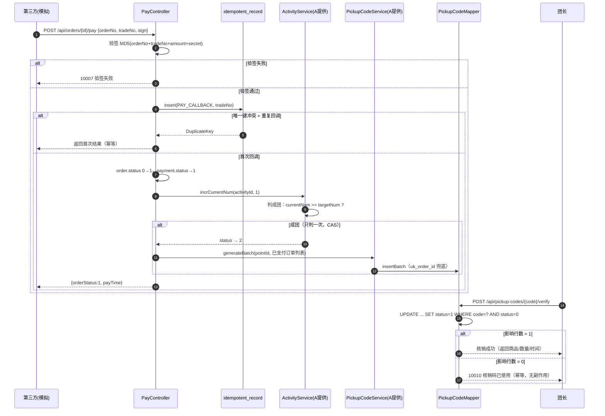

# 时序图：支付回调 → 成团 → 核销（C 负责，Issue #19—#21）

## 三处幂等（报告第 5 章亮点）

| 场景 | 幂等落点 | 验收 |
|---|---|---|
| 支付回调重放 | `payment.uk_trade_no` + `idempotent_record(biz_type,biz_key)` | 同 trade_no 两次只入账一次 |
| 成团重复判定 | `activity.version` 乐观锁 + 状态机（2 是终态） | 只加一次人数、只发一次码 |
| 核销重复提交 | `UPDATE ... WHERE status=0` 影响行数判断 | #29 同码 5 次仅 1 次成功 |
