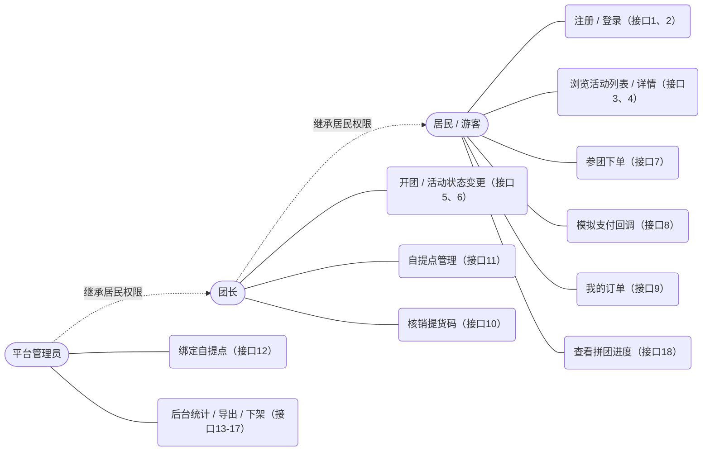

# 用例图、用例描述表与三角色权限矩阵（Issue #12）

> 依据：[接口契约 v1.0](../api.md)（已冻结）。用例编号与接口编号一一对应，涉及的功能以契约为准。
> 三种正式角色：`ROLE_RESIDENT`（居民）、`ROLE_LEADER`（团长）、`ROLE_ADMIN`（平台管理员）。**游客**指未登录的调用方，不是一种角色。

## 一、用例图

## 二、用例描述表

| 用例 | 名称 | 主参与者 | 前置条件 | 基本事件流 | 后置条件 / 异常 |
|---|---|---|---|---|---|
| UC-01 | 注册 / 登录（#1、#2） | 游客 | 无 | 提交用户名密码与 `roleCode` → 服务端 BCrypt 加密入库 → 登录签发 JWT | 返回 token；用户名重复 10012，密码错 10013，非法角色 400 |
| UC-02 | 浏览活动（#3、#4） | 游客 / 全体 | 活动已存在 | 分页条件查询（`keyword/status/pointId` 动态 SQL）→ 查看详情（Cache-Aside，空值缓存 + 逻辑过期 + TTL 抖动） | 只读，不改数据；活动不存在 10001 |
| UC-03 | 开团（#5） | 团长 | 已登录且角色为团长 | 提交活动与商品信息 → 初始化 `stock` → 活动初始状态 0（待开始） | 生成活动 id；时间格式错 400 |
| UC-04 | 活动状态变更（#6） | 团长 / 管理员 | 活动存在；团长只能改自己的团 | 按显式转移表校验 `0→1→2/3` 与下架 `4` → 非法流转拒绝 | 状态落库；非法流转 10014 |
| UC-05 | 参团下单（#7） | 居民 / 团长 | 活动进行中且在时间窗内、未超购限 | ① 令牌桶限流 → ② Lua 原子预扣 Redis 库存 → ③ `INSERT order_info` + `UPDATE stock ... WHERE available>=?`（CAS 兜底） | 生成订单号与支付截止时间；③ 失败必须回滚预扣。限流 429、库存不足 10003、超购 10004、重复下单 10015 |
| UC-06 | 模拟支付回调（#8） | 登录用户 | 订单存在且未支付 | 验签 → `payment.uk_trade_no` / `idempotent_record` 判重 → 订单 0→1、写 `pay_time` → 更新 `current_num` 触发成团判定（#20） | 同一 `trade_no` 重复回调返回首次结果；验签失败 10007 |
| UC-07 | 我的订单（#9） | 登录用户 | 已登录 | 按当前用户分页查询；管理员可查全部 | 仅 `status=2`（已成团待提货）时返回 `pickupCode` |
| UC-08 | 核销提货码（#10） | 团长 | 是该提货点所属团长、码未使用 | `UPDATE pickup_code SET status=1 ... WHERE code=? AND status=0`，按影响行数判成功 | 影响行数 1 成功，0 说明已用 → 10010；码不存在 10009；非本点团长 403。同一码连核 5 次仅 1 次成功 |
| UC-09 | 自提点管理（#11） | 管理员（新增 / 修改 / 停用） | 已登录 | 新增 / 修改自提点；停用时把 `status` 置 0（逻辑删除） | 列表只返回 `status=1` 的启用项 |
| UC-10 | 绑定自提点（#12） | 管理员 | 团长与自提点均存在 | 设置 `leader.point_id` → 唯一索引 `uk_point_id` 防重复绑定 | 绑定成功不立即生成核销码；已被占用 10016。核销码在成团时由 `PickupCodeService` 批量生成 |
| UC-11 | 后台统计 / 导出 / 下架（#13—#17） | 管理员 | 已登录且角色为管理员 | 查成团率 / 退款对账 / 团长排行 → EasyExcel 导出（≥300 行）→ 下架活动（有待支付订单时联动 C 取消退款） | 全部为管理员接口；下架调 A 的服务 |
| UC-12 | 查看拼团进度（#18，加分项） | 全体 | 活动存在 | SSE 推送或前端 3 秒轮询 `GET /api/activities/{id}/progress`，读 `currentNum` | 只读；无权限要求 |

## 三、三角色权限矩阵

> ✅ 允许 ｜ ⭕ 条件允许（见备注）｜ ❌ 禁止 ｜ 游客 = 未登录

| # | 接口 | 游客 | 居民 | 团长 | 管理员 | 备注 |
|---|---|:---:|:---:|:---:|:---:|---|
| 1 | `POST /api/auth/login` | ✅ | ✅ | ✅ | ✅ | 无需 token |
| 2 | `POST /api/users/register` | ✅ | ✅ | ✅ | ✅ | `roleCode` 默认 `ROLE_RESIDENT` |
| 3 | `GET /api/activities` | ✅ | ✅ | ✅ | ✅ | 游客可看 |
| 4 | `GET /api/activities/{id}` | ✅ | ✅ | ✅ | ✅ | 游客可看 |
| 5 | `POST /api/activities` | ❌ | ❌ | ✅ | ⭕ | 契约标注团长；管理员作为超管可放行 |
| 6 | `PUT /api/activities/{id}/status` | ❌ | ❌ | ⭕ | ✅ | 团长仅限自己的团，管理员全部 |
| 7 | `POST /api/orders` | ❌ | ✅ | ✅ | ⭕ | 契约允许居民 / 团长；管理员一般不下单 |
| 8 | `POST /api/orders/{id}/pay` | ❌ | ⭕ | ⭕ | ⭕ | 仅限自己的订单 |
| 9 | `GET /api/orders` | ❌ | ⭕ | ⭕ | ✅ | 普通用户只看自己的，管理员看全部 |
| 10 | `POST /api/pickup-codes/{code}/verify` | ❌ | ❌ | ⭕ | ❌ | 必须是该提货点的团长 |
| 11 | `GET /api/pickup-points` | ✅ | ✅ | ✅ | ✅ | 只返回启用项 |
| 11 | `POST /api/pickup-points` | ❌ | ❌ | ❌ | ✅ | 新增 |
| 11 | `PUT /api/pickup-points/{id}` | ❌ | ❌ | ❌ | ✅ | 修改 |
| 11 | `DELETE /api/pickup-points/{id}` | ❌ | ❌ | ❌ | ✅ | 逻辑删除（status 置 0） |
| 12 | `PUT /api/leaders/{id}/bind-point` | ❌ | ❌ | ❌ | ✅ | 唯一索引防重复绑定 |
| 13 | `GET /api/admin/statistics/group-rate` | ❌ | ❌ | ❌ | ✅ | 成团率统计 |
| 14 | `GET /api/admin/statistics/refund-reconciliation` | ❌ | ❌ | ❌ | ✅ | 退款对账 |
| 15 | `GET /api/admin/statistics/leader-ranking` | ❌ | ❌ | ❌ | ✅ | 团长业绩排行 |
| 16 | `GET /api/admin/statistics/export` | ❌ | ❌ | ❌ | ✅ | EasyExcel 导出 |
| 17 | `POST /api/admin/activities/{id}/offline` | ❌ | ❌ | ❌ | ✅ | 活动下架，调 A 的服务 |
| 18 | `GET /api/activities/{id}/progress` | ✅ | ✅ | ✅ | ✅ | 加分项，无权限要求 |

权限由 D 的 JWT 拦截器与角色校验统一处理（见 `common/JwtUtil.java`、`config/AuthInterceptor.java`）。矩阵中标记 ⭕ 的条目以接口契约中的「权限」行和拦截器实现为准；若实际行为与矩阵不一致，按「接口变更」流程更新契约并同步本文件。
